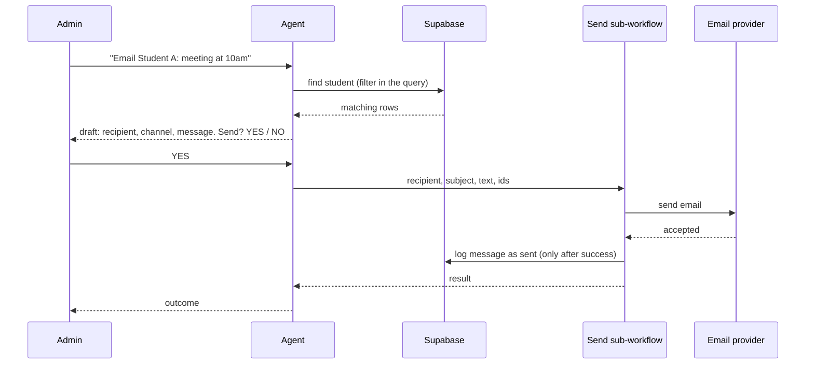

# Architecture

## 1. Request lifecycle

1. The admin sends a WhatsApp message to the business number.
2. The WhatsApp Trigger starts the main workflow.
3. A Supabase lookup checks the sender against the `admins` table.
4. An If node routes: not an admin gets a fixed refusal, and the agent never runs. An admin goes to the agent.
5. The agent reads the message and its memory, then chooses tools by name and description.
6. The agent's reply goes back to the admin. If the agent node itself fails, its error output replies to the admin and alerts the developer.

## 2. Agent design

- One agent with direct tools. Sub-agents were rejected: each adds model calls, latency and misinterpretation risk.
- Tools are selected only from their names and descriptions, so each tool has a narrow purpose and says when not to use it.
- Max iterations is capped so a failing tool cannot loop.
- Memory is keyed by the admin's sender id, which lets the agent connect a later "YES" to the draft it just showed.
- Lookups use database filters. The model never receives a table to search.

## 3. Sending one message

Logging happens after the send. If the email step fails, the log step never runs, so history never shows a send that did not happen.

## 4. Sending to all parents

The agent passes only the subject and text. The sub-workflow reads every parent row and runs the email node once per item, since n8n runs a node once per incoming item. The model never sees or edits the recipient list, so it cannot drop or invent a recipient.

## 5. Failure handling

| Failure | What catches it | Needs the model to behave? |
|---|---|---|
| Agent node crashes (model down, iteration cap) | Agent error output: reply to admin + developer alert | No |
| Node after the agent fails (reply node) | Separate error workflow | No |
| A tool fails and the agent recovers | `alert_developer` tool | Yes, best effort |
| Unauthorized sender | If node, fixed refusal, agent never runs | No |

Developer alerts use a channel that works outside WhatsApp's 24-hour window, because WhatsApp free-form messages to a number that has not written recently are rejected.

## 6. Data integrity

- Foreign keys tie every message to an admin and every recipient to a message.
- CHECK constraints fix the allowed channels and statuses, and require exactly one recipient type per recipient row.
- A unique pair constraint stops the same student and parent being linked twice.
- RLS is enabled on every table. The backend uses the service-role key server-side only.

## 7. Trade-offs and what changes before real data

- **The YES gate is prompt-enforced.** A model can still call a send tool by mistake. The fix is to store a pending message and let the workflow check for it before any send, so the model cannot bypass it.
- **"Sent" is not "delivered."** Delivery needs the provider's status or bounce signal.
- **WhatsApp to recipients** needs recipient consent and approved templates outside the 24-hour window.
- **Real school integration** is unknown until a school chooses a system. The tools are written around what they do, not how the demo stores data, so only their internals would change.
